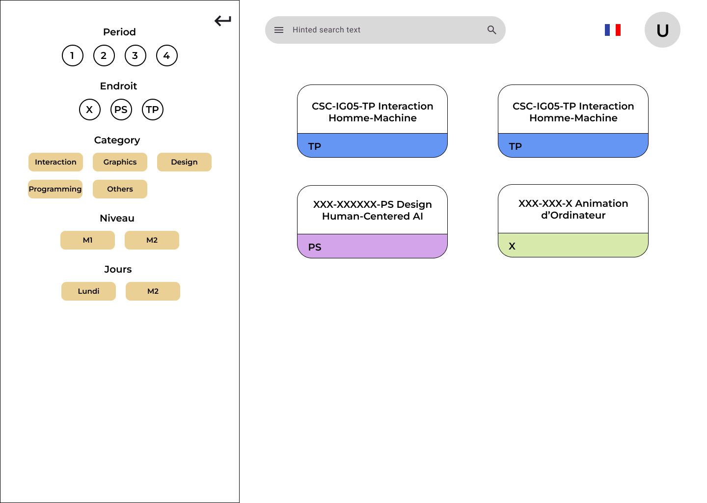
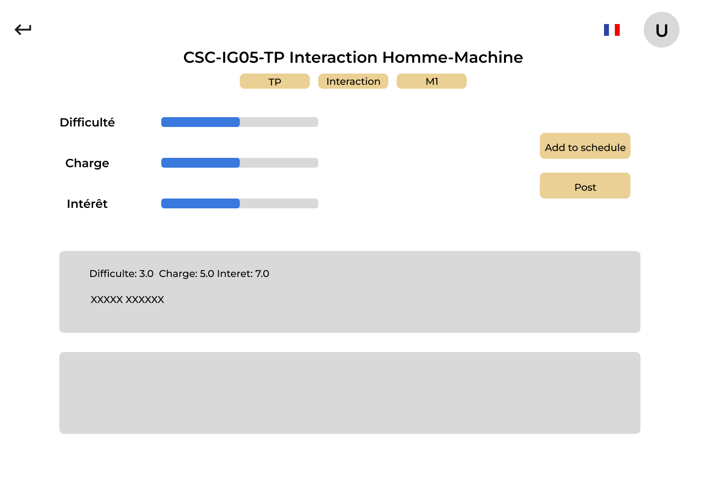
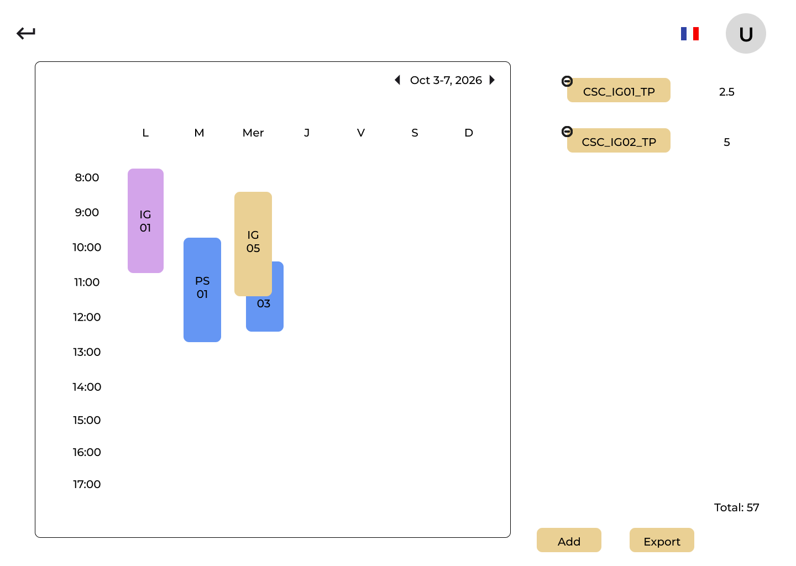
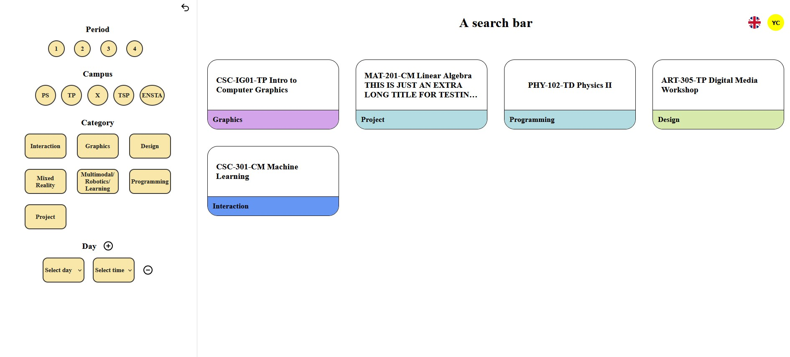

# registration-planner
This is a course registration planner made for IGD students to simplify the administrative process by centralizing feedback on courses offered by the master's program, as well as offering a scheduling tool that helps students select courses while avoiding having overlap.

## Concept
The project is current under construction. 
After conducting semi-structured interview with 10 students from my master program and summarizing the pain points that they are experiencing now, I have identified three different features that are necessary for the application:


1. **Course Selection**


Most students have specific needs on the category / time / location... of the classes that they want to choose. Hence, a flexible filter based on the actual user needs is highly needed.

2. **Course Review**


Aside from the filter, students also mentioned that having feedback from previous students could help them make decision. However, such practice does not exist currently in our program. So this application will also include to provide further information on the catalogue.

3. **Course Scheduling**


This is the most important and necessary feature of the application. Many students complained about having to figure out the overlaps between classes manually on paper, or with an external calendar, or excel. Some mentioned the lack of a visualization tool. This application will provide a calendar plug-in that visualizes automatically the timetable of all classes offered by our master's program while allowing users to add their own free credit classes, making it practical and flexible at the same time.

## Updates

- **October: The interview has been completed and the three features have been painted out using Figma.**



*Main page of the tool, corresponding to feature 1*



*After entering the detailed page of each course, corresponding to feature 2*



*The calendar page with the option to add your own course as well as automatic calculation to avoid missing ECTS and of course, a good old option to export everything so you can show your good work to the adminstration to get approved :D*

- **November: Working on Feature 1**


*Having researched on the tech stack and code organisation as well as the plug-ins for the calendar, c'est parti ! Currently, I have a working filter for which I have written tests. The next step is to finish up the search functionality and move on to the second feature.*

The filter lets students narrow the course list by period, campus, and category, as well as by meeting day and time (morning, afternoon, or all day). These options can be combined to find courses that fit their preferences and schedules.

## Frontend: How To

The React frontend lives in `frontend/` and uses Vite with TypeScript.

1. Install Node.js (20.19+ or 22.12+) and npm.
2. From the `frontend/` directory, install dependencies:

   ```sh
   npm install
   ```

3. Start the local development server:

   ```sh
   npm run dev
   ```

Open the local URL printed by Vite (usually `http://localhost:5173`). Edit
`frontend/src/App.tsx` to start building the interface.

To check types and create a production build, run `npm run build` from
`frontend/`. To serve that build locally, run `npm run preview`.
